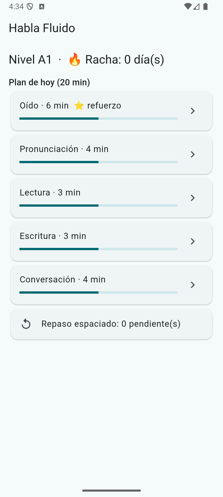
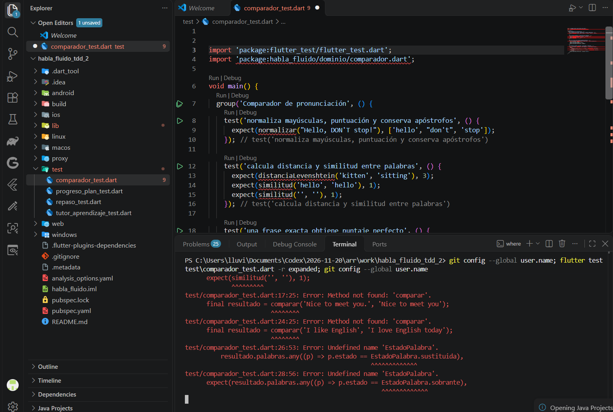
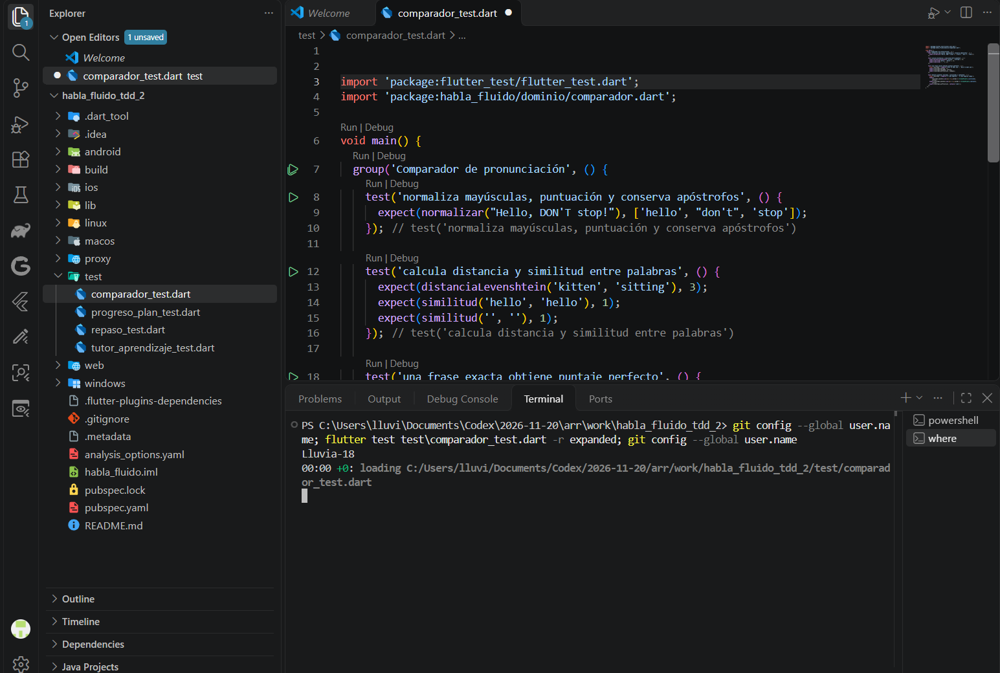
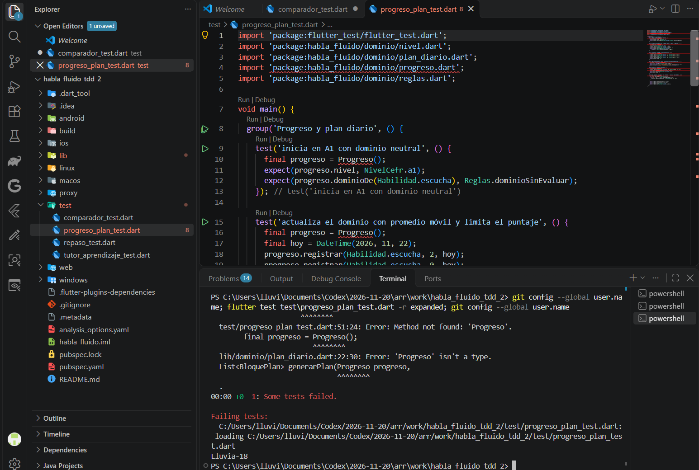
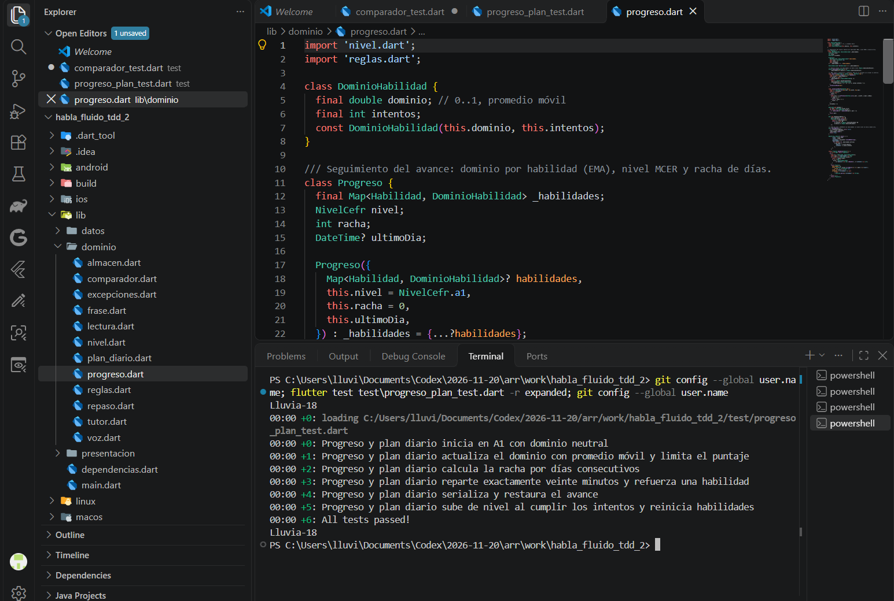
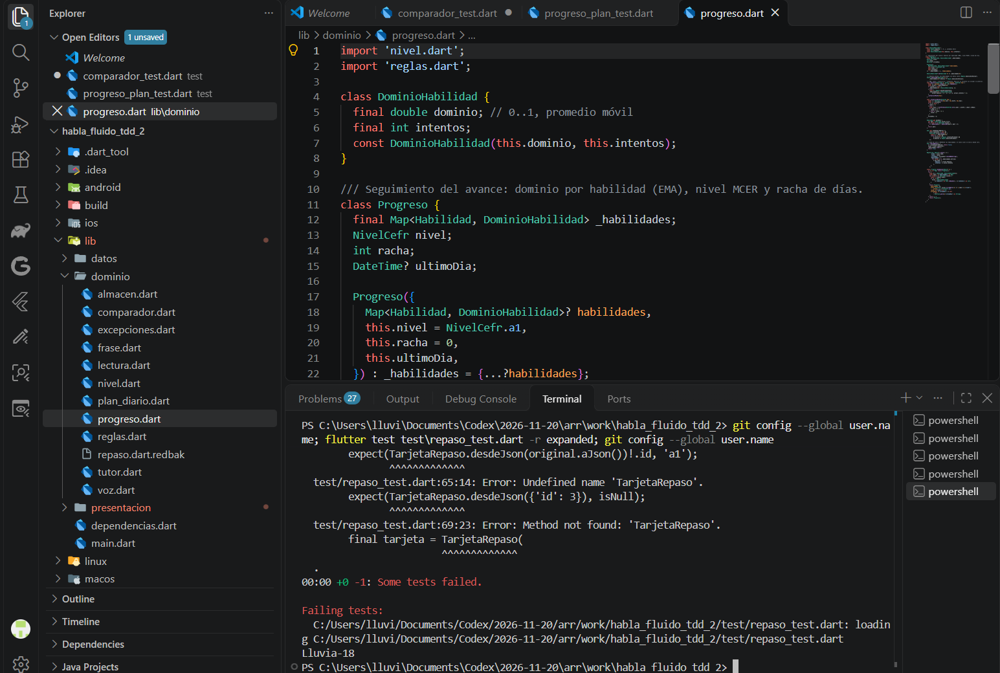
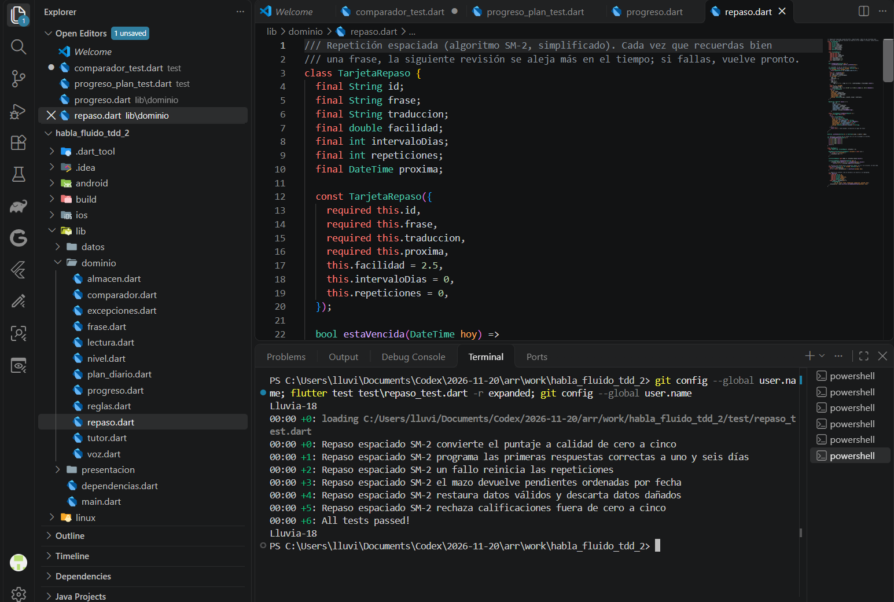
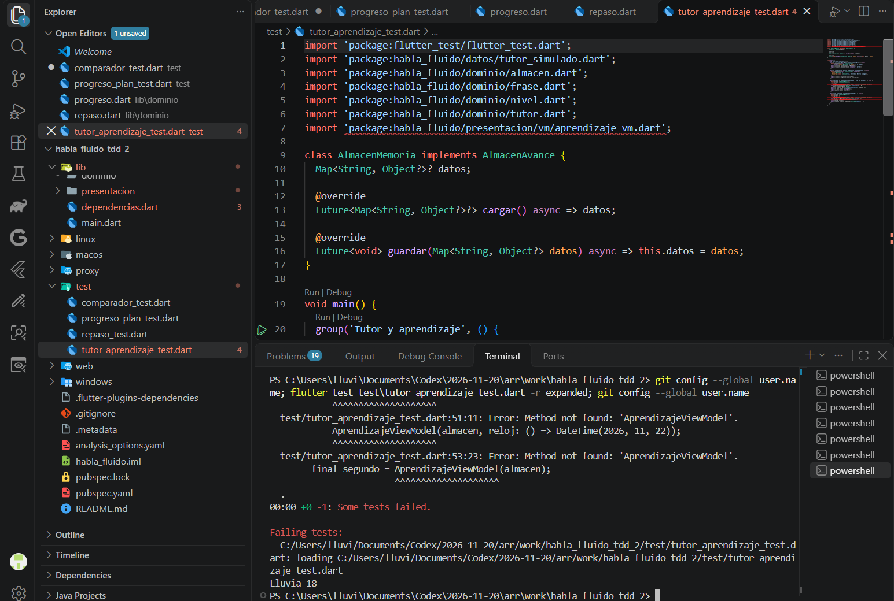
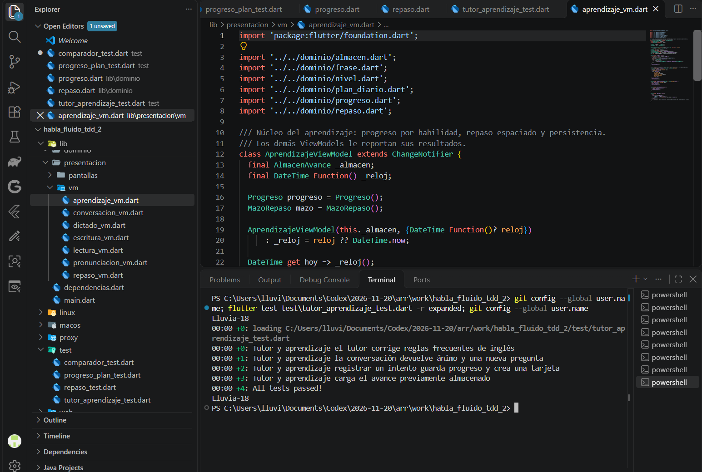
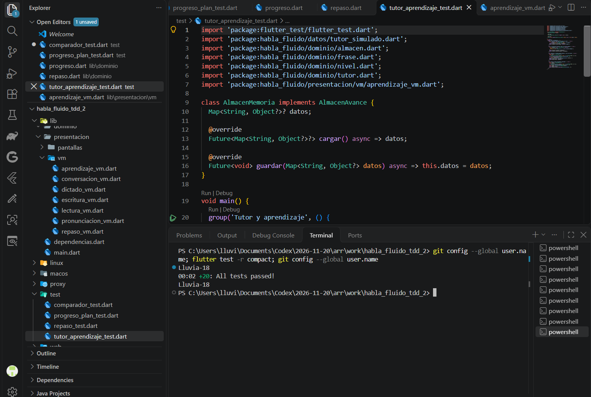

# Habla Fluido

Aplicación móvil desarrollada con Flutter para practicar inglés mediante un plan diario personalizado, ejercicios de pronunciación, lectura, escritura, conversación y repaso espaciado.

**Autora:** Lluvia Villanueva — GitHub: [Lluvia-18](https://github.com/Lluvia-18)

## Aplicación terminada

La pantalla principal distribuye una sesión de 20 minutos entre cinco habilidades. La habilidad con menor dominio recibe un bloque de refuerzo y el progreso se conserva en el dispositivo.

<p align="center">
  
</p>

## Funcionalidades

- Plan diario de escucha, pronunciación, lectura, escritura y conversación.
- Seguimiento de nivel MCER, dominio por habilidad y racha diaria.
- Comparación de pronunciación palabra por palabra.
- Repaso espaciado mediante una adaptación del algoritmo SM-2.
- Tutor simulado que funciona sin conexión y tutor remoto opcional.
- Persistencia local del progreso.
- Síntesis y reconocimiento de voz mediante los servicios del dispositivo.

## Desarrollo guiado por pruebas

La entrega original no incluía una carpeta `test`. Para verificar sus reglas reales se agregó una suite de **20 pruebas automatizadas**, organizada en cuatro ciclos TDD. En cada ciclo se conserva la evidencia de la fase roja —la prueba falla porque falta la implementación— y la fase verde —la implementación satisface el comportamiento esperado—.

Todas las capturas muestran el código, la terminal integrada de Visual Studio Code y la identidad Git `Lluvia-18`.

### Ciclo 1 — Comparador de pronunciación

Se verifican la normalización del texto, distancia de Levenshtein, similitud, puntaje perfecto y detección de palabras sustituidas o sobrantes.

#### Fase roja



#### Fase verde



### Ciclo 2 — Progreso y plan diario

Se prueban el promedio móvil del dominio, los límites de puntaje, la racha, la distribución exacta de 20 minutos, la persistencia y el cambio de nivel.

#### Fase roja



#### Fase verde



### Ciclo 3 — Repaso espaciado SM-2

Se validan la conversión de puntaje a calidad, los intervalos de uno y seis días, el reinicio después de un fallo, el orden de pendientes y la recuperación segura de datos.

#### Fase roja



#### Fase verde



### Ciclo 4 — Tutor y aprendizaje

Se comprueban las correcciones del tutor, la generación de una pregunta nueva, el registro de intentos, la creación de tarjetas y la carga del progreso guardado.

#### Fase roja



#### Fase verde



## Ejecución completa

El resultado final de la suite es **20 pruebas aprobadas**.



## Casos cubiertos

| Archivo | Pruebas | Responsabilidad |
| --- | ---: | --- |
| `comparador_test.dart` | 4 | Normalización, Levenshtein y comparación de frases |
| `progreso_plan_test.dart` | 6 | Progreso, racha, plan diario y nivel |
| `repaso_test.dart` | 6 | Algoritmo SM-2 y persistencia de tarjetas |
| `tutor_aprendizaje_test.dart` | 4 | Tutor, ViewModel y almacenamiento |
| **Total** | **20** | **Suite completa** |

## Ejecutar el proyecto

Requisitos: Flutter SDK, Android SDK y un emulador o teléfono Android.

```powershell
flutter pub get
flutter analyze
flutter test
flutter run
```

## Resultado verificado

- `flutter analyze`: sin problemas.
- `flutter test`: 20 pruebas aprobadas.
- APK de depuración compilado correctamente.
- Aplicación instalada y ejecutada en `emulator-5554` con Android 16.

## Privacidad

El reconocimiento de voz utiliza el servicio de voz del sistema operativo; el audio puede ser procesado por el proveedor del dispositivo. La aplicación debe informar esta condición al estudiante antes de usar el micrófono. El tutor simulado no requiere internet.
